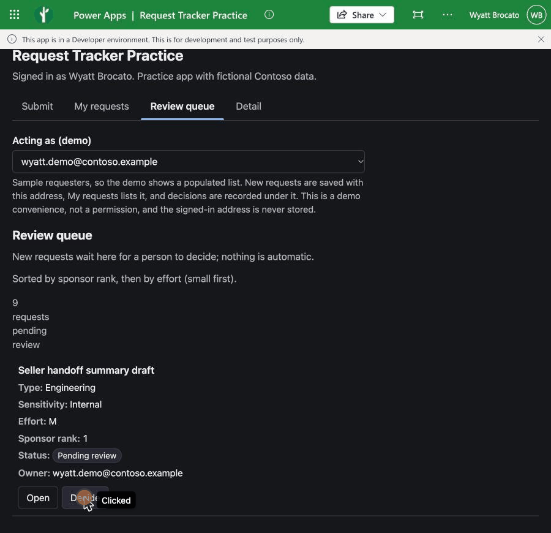
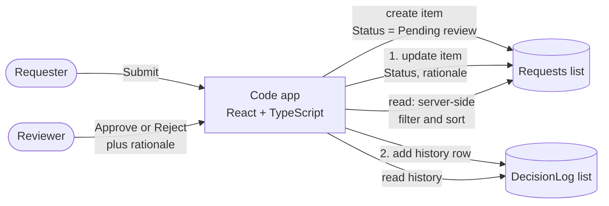

# Contoso Request Tracker

> A practice build I made in November 2026 in a Microsoft environment, with fictional Contoso data. It is not production, it was not shared, and it is not based on any Microsoft internal system.

## Start here

**What it is:** a small demo of a request-and-decision workflow, built as a Power Apps code app (React and TypeScript) on two SharePoint lists, where a person decides and writes down the reason.

**Look at it in 60 seconds**

1. Read "What this shows" below.
2. Watch the [walkthrough clip](#walkthrough).
3. Read [the decision rule](#the-decision-rule).

**Look at it in 5 minutes**

1. Read [the decision rule](#the-decision-rule) and [the architecture and data flow](#architecture-and-data-flow).
2. Read [how the blocked approval connector was handled](#an-approval-connector-was-blocked-so-the-decision-lives-in-the-app) and [the plan from test to production](#from-test-to-production-planned-not-executed).
3. Read [how AI was used in this build](#ai-in-this-build) and [how the app handles accessibility](#how-this-app-handles-accessibility).

**What this shows**

- Hands-on work with a Power Apps code app on SharePoint lists.
- A workflow where a person decides, with a written reason and a history of decisions.
- Server-side filtering and sorting, so the lists stay fast as they grow.
- Automated checks (type check, lint, build) running in GitHub Actions on every push.
- A written test-to-production path, labelled planned, not executed.
- Agent-assisted development, with the checks every change must pass.

**What this is not**

- Not production, and not a product.
- No AI feature: the app does not use AI to decide or suggest anything.
- No Power Automate flow: Power Automate is not used in this demo.
- Not real data: every name and address is fictional (sample addresses on `contoso.example`).

## Walkthrough

A short clip of the main path. The same steps are listed in words below the clip, and there is a still image if you prefer not to play it.



*The clip shows the same app, built in a practice environment.*

1. Open the **Review queue** tab. It lists the requests waiting for a decision, sorted by sponsor rank and then effort.
2. Choose **Decide** on a request. The panel "Reviewer decision; nothing is automatic" opens under it.
3. Type a reason. Approve and Reject only become available once there is one.
4. Choose **Approve**, then **Confirm approval**.
5. A message says the request was marked Approved and its history entry was saved.
6. Open **My requests** and a request's **Detail** page to see its decision history.

[Still image of the decision panel](docs/walkthrough-still.png)

## The problem

Many teams ask one small team for work, and there is never room for all of it. Someone has to rank the asks, see what is waiting, decide, and keep a record of why. This build is a small, honest version of that: submit a request, see the queue in a fixed order, record a human decision with a reason, and read the history.

| # | Requirement | Where it is met |
| --- | --- | --- |
| R1 | Anyone can submit a request with a clear outcome, a sensitivity, an effort and a rank | Submit view, with validation |
| R2 | The queue order is predictable and explainable | Review queue: sponsor rank, then effort (see the decision rule) |
| R3 | A person decides, with a written reason, and nothing happens automatically | Reviewer decision panel (Approve or Reject, rationale required, confirm step) |
| R4 | Every decision leaves a history row | DecisionLog list, shown in Detail |
| R5 | Sensitive requests are marked and the right reviewers are told | Data sensitivity field and help text (the enforcement belongs to list permissions) |
| R6 | A failed save is never silent | Friendly errors, and a retry for the second of the two writes |
| R7 | Lists stay fast as they grow | Server-side filters and sorts only (see known limits) |
| R8 | The path to production is written down | From test to production, below |

## The decision rule

1. A new request is saved by the app with status **Pending review**, so it lands in the review queue straight away.
2. No Power Automate flow is used in this demo. Nothing moves a request between statuses except a person.
3. The review queue lists Pending review items by **sponsor rank** (1 is highest), then by **effort** (small first).
4. A reviewer picks Approve or Reject, **must write a rationale**, and confirms.
5. Only then does the app write: it updates the request, then adds a history row.

Nothing is decided by a rule or a model. The ranking only decides the order in which a person sees the work. The `AISuggestionUsed` column exists so a future version can record whether a suggestion was used; in this build it is always `No`.

## Architecture and data flow



The same flow in words:

1. A requester submits a request in the app. The app saves it in the Requests list with the status Pending review.
2. A reviewer opens the review queue, picks Approve or Reject, and writes a reason.
3. The app first updates the request in the Requests list (status and reason), then adds a row to the DecisionLog list.
4. To show screens, the app reads the lists: the queue is filtered and sorted on the server, and the history is read from the DecisionLog list.

- The app talks to SharePoint only through services generated by the Power Apps CLI (`src/generated`). Hand-written code never builds a connector call itself.
- Reads filter and sort on the server (`eq` on text and number columns, sorts on text, number and date columns).
- The two writes of a decision are **not atomic**. If the second fails, the app says the request is already decided, and retries only the history row, so a request is never decided twice.

## Data model

Two SharePoint lists.

**Requests**

| Column | Type | Notes |
| --- | --- | --- |
| Title | text | required in the form |
| RequestType | choice | Engineering, Non-engineering |
| BusinessOutcome | multi-line text | |
| Sponsor | text | optional |
| SponsorRank | number | whole number, 1 or higher; 1 is highest priority |
| Effort | choice | S, M, L |
| EffortRank | number | 1, 2, 3; a number mirror of Effort so the queue can sort on a delegable column |
| DataSensitivity | choice | Public, Internal, Confidential |
| Status | choice | Draft, Submitted, Pending review, Approved, Rejected, Needs attention |
| StatusText | text | text mirror of Status; the queue filters on this because filtering on a choice column is less reliable |
| OwnerEmail | text | the requester; stored and compared lower-case |
| DecisionRationale | text | |

**DecisionLog**

| Column | Type | Notes |
| --- | --- | --- |
| Title | text | `Decision for request N` |
| RequestID | number | the Requests item ID |
| Decision | choice | Approved, Rejected |
| DecidedBy | text | |
| Rationale | text | |
| AISuggestionUsed | choice | Yes, No |
| DecidedOn | date and time | |

Sensitivity guidance shown under the picker: Public is safe to share broadly (one reviewer); Internal is employees only (one reviewer); Confidential is named people only and adds a data-owner approval.

## Permission model

- **Hiding a screen is not security.** The Review queue tab being visible or not controls convenience only. The code says so next to the view.
- **The real control is the SharePoint list permissions.** Who can read or change a row is decided by the list (and, for Confidential rows, by item-level permissions, which this demo does not set up).
- The app uses each person's own SharePoint connection, so people see only what their permissions allow.
- The **Acting as** selector in the demo chooses which sample requester a request is saved under and whose requests are listed. It is a demo convenience, not a permission. The signed-in user's address is never read, stored or queried.
- Demo data uses sample addresses on `contoso.example`. They are fictional and receive no mail.

## An approval connector was blocked, so the decision lives in the app

In the environment I built this in, a connector policy blocked the Approvals connector (error 442). I did not change the policy; I moved the human decision into the app instead.

Trade-offs of that choice:

- You lose approval emails and Teams cards, built-in reminders, and the approvals history that comes with the connector.
- The audit trail is the DecisionLog list the app writes, and the two writes are not atomic.
- The app does not check who is allowed to decide; list permissions do. In production, the decision would go back through an approval step, or through a role check on a governed store.

## From test to production (planned, not executed)

Nothing below has been done for this repo. It is the plan I would follow.

| Step | Plan | Check first |
| --- | --- | --- |
| Environments | Separate development, test and production environments | Which environments exist and who administers them |
| Packaging | Put the app (and any flow added later) in a solution so they move together | Code apps join a solution only in an environment with Dataverse; they publish without one otherwise |
| Settings | Move the SharePoint site and list names out of the app into environment variables, and use connection references for the connection | Whether environment variables cover code app data sources |
| Import | Import the solution into test and production as **managed**; deploy through pipelines where Dataverse is available | Pipelines need Dataverse and managed environments |
| Solution checker | Run it on the solution before each import | Whether it covers code apps |
| Review | Security and compliance review: data classification, connector and data policies, who can reach the lists | Which policies already apply |
| Rollback | Keep the previous managed solution version and the previous build, so rolling back is re-importing the previous version | Test the rollback once before go-live |

Reference: [Application lifecycle management for code apps](https://learn.microsoft.com/power-apps/developer/code-apps/how-to/alm). Code apps do not support source-control integration for solutions at this time, so this repo holds the app source and the solution is exported separately.

## How this app handles accessibility

Everything below was checked in the source code. It describes what exists, not a full audit.

- **Labels.** Every form field has a visible label that is tied to the field. Required fields are marked as required for assistive technology.
- **Errors in words.** A field with a problem is flagged as invalid, and its message is plain text linked to the field. A "Still needed" line lists what is missing, and the Submit button stays disabled until the form is valid.
- **Not colour alone.** Statuses are always words (Pending review, Approved, Rejected). Error and success banners say what happened in text.
- **Announcements.** Errors use an alert role, saving and loading use a status role, and the success message is in a polite live region, so assistive technology can announce them.
- **Keyboard.** The tabs can be reached from the keyboard, with the arrow keys, Home and End to move between them. A "Skip to content" link comes first. All actions are real buttons. A visible focus outline is set for keyboard focus. When the confirm step of a decision opens, focus moves to the confirm button.
- **Tables.** Tables have captions and column headers, and the first column is a row header. The "Open" column header is hidden visually but available to assistive technology. Buttons name the request they act on, for example "Open details for Seller handoff summary draft".
- **Grouping.** The decision panel is a labelled group with the legend "Reviewer decision; nothing is automatic".
- **Layout and theme.** Below 1000 pixels wide, table rows stack into blocks so nothing needs sideways scrolling. Light and dark follow the system setting. The page language is declared.

Not done or not verified:

- **Not yet tested with a screen reader.** The roles and labels are set, but I have not listened to the result.
- **Colour contrast has not been measured with a tool.** The colours were chosen by hand.
- **Stacked tables.** In the narrow layout the rows are shown as blocks, and some screen readers may stop announcing them as tables.

## Known limits

- **List size and delegation.** SharePoint list views slow down past 5,000 items, so the lists need indexes on StatusText, OwnerEmail and RequestID. The app uses only server-side filters and sorts, and reads all pages. A client-side re-sort of the pending subset backs up the two-key queue sort.
- **No concurrency guard.** If two reviewers open the same request, the last write wins.
- **No automated behaviour tests.** CI proves the code type-checks, lints and bundles. Behaviour against the real lists is checked by hand in the Power Apps host.
- **When to move to Dataverse.** When you need row-level security roles instead of per-item list permissions, relational integrity between requests and decisions, atomic multi-table writes, auditing, or standard solution-based deployment with environment variables.

## AI in this build

- **What the coding agent did.** A coding agent drafted most of the React and TypeScript views, the CI configuration and the first version of this README from a written specification that I supplied (screens, validation, sort order, the decision rule and the sample-address rule).
- **What it did not do.** It did not write the data-access layer: `src/generated` is produced by the Power Apps CLI. It did not decide the behaviour, and the build has no AI feature.
- **What I check by hand.** I read each change before it is merged, run the app through the Power Apps host against sample data, and look for personal or environment-specific values before every commit.
- **Checks every change must pass.** `npx tsc -b` (type check), `npm run lint`, `npm run build`, and a scan for environment, tenant and personal identifiers. The first three run in GitHub Actions on every push and pull request.

## What I would change with more context

- Ask who the real decision-makers are and replace the demo Acting as selector with real identity and a role check.
- Add Power Automate where it earns its place: notifications, escalation of requests that wait too long, and an approval step once the connector policy allows. No Power Automate flow is used in this demo.
- Put the decision behind an approval step or a governed store, once policy allows it.
- Move the two-step write server-side with an idempotency key, and add a status check so a request cannot be decided twice.
- Add tests with a mocked data layer, then an end-to-end run against a test environment.
- Add reminders for requests that have waited too long, and a measure of time to decision.
- Move to Dataverse if the list grows or sensitivity rules need real security roles.
- Run an accessibility pass with a screen reader.

## Run it

You need Node 20.19 or newer, the Power Apps CLI (`pa`), and a Power Platform environment where code apps are enabled.

```
npm install
npm run build        # type check, then bundle
npm run lint
```

To run against your own lists:

1. Create the two lists described under Data model in a SharePoint site you control.
2. Copy `power.config.example.json` to `power.config.json` and set your own environment and connection values. That file is git-ignored on purpose.
3. Sign in with the CLI, then regenerate the data layer with `pa app add data-source` for each list. This writes `src/generated` and the schema files under `.power/schemas/`. The schema files for the lists contain your site address, so they are git-ignored; one ID-free file, `.power/schemas/appschemas/dataSourcesInfo.ts`, is kept in the repo so CI can build without a sign-in.
4. `pa app run` to try it locally.

Seed the lists with fictional rows only.

## Repository map

| Path | What it is |
| --- | --- |
| `src/views` | Submit, My requests, Review queue, Detail |
| `src/components/DecisionPanel.tsx` | The human decision and its two-step write |
| `src/lib/data.ts` | All reads and writes, through the generated services |
| `src/generated` | Generated by the Power Apps CLI; do not edit |
| `.github/workflows` | CI (type check, lint, build) and a tagged-release build |
| `SECURITY.md` | What must never be committed |

## Licence

MIT. See [LICENSE](LICENSE). Copyright (c) 2026 Wyatt Brocato.
